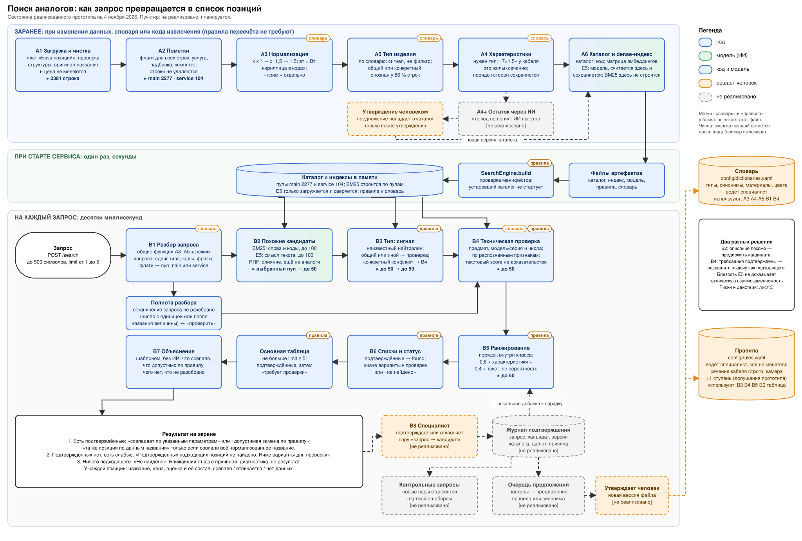
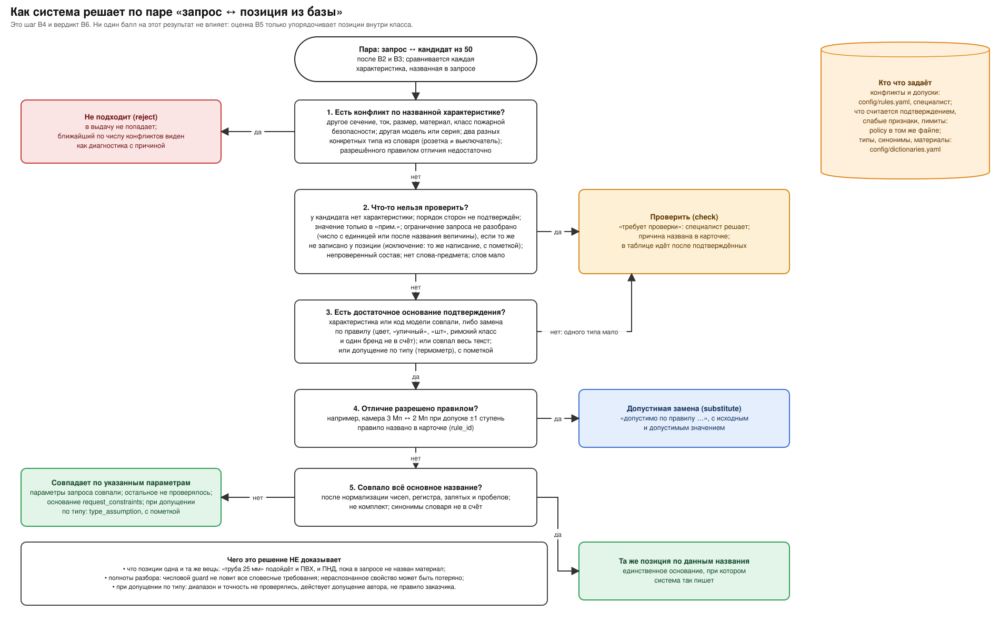
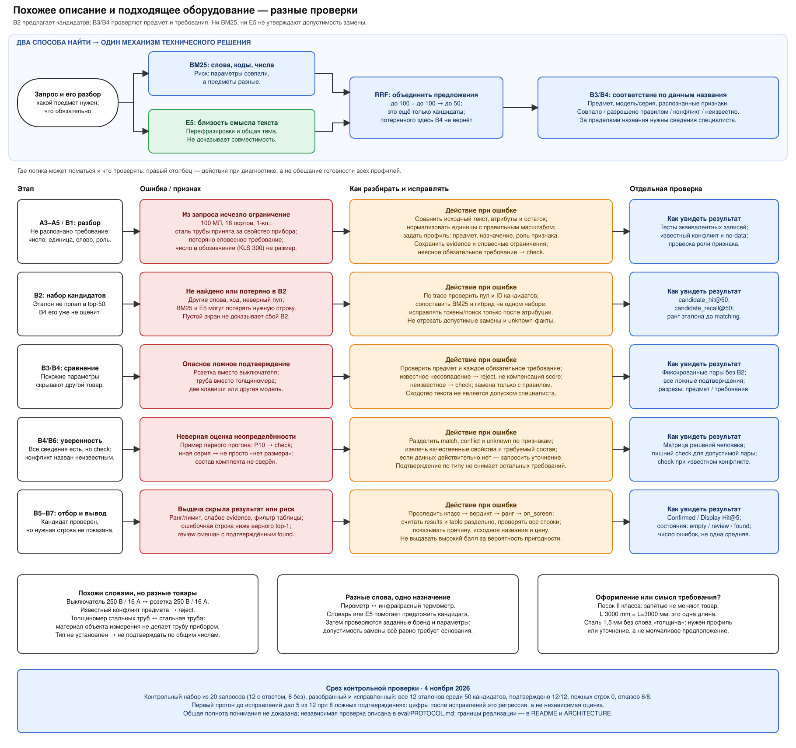

# ARCHITECTURE: поиск аналогов материалов и оборудования

> **Что это.** Описание **реализованного прототипа** на 5 ноября 2026 (938 тестов). Не реализовано и отмечено пунктиром на схеме: разбор остатка через ИИ (A4+) и подтверждения специалиста (B8). Цифры в этом документе получены на наборах, по ошибкам которых систему исправляли, и не являются независимой оценкой качества (раздел 11).

**Схема поиска** (источник один: `scripts/build_scheme.py`; `docs/scheme.drawio` и SVG рядом генерируются из него командой `python scripts/build_scheme.py --overwrite` и руками не правятся):



**Как система решает по паре «запрос ↔ позиция из базы»** (второй лист схемы):



**Сходство описаний, техническое соответствие и точки отказа** (третий лист схемы):



На третьем листе разделены три понятия: **совпадение слов и кодов** (BM25), **близость смысла описаний** (E5) и **соответствие оборудования требованиям запроса** (B3/B4). Первые два предлагают кандидатов. Третье проверяется по предмету, модели/серии и извлечённым характеристикам; допустимое отличие требует правила. Общая тема или совпавшие числа не заменяют эту проверку. Например, стальная труба не становится толщиномером для стальных труб, а пирометр и инфракрасный термометр могут обозначать один вид прибора, но всё равно требуют проверки заданных параметров.

**Граница текущего подхода:** словари, извлечение и правила не гарантируют полного понимания технического смысла. Числовой guard не обнаруживает все словесные требования; роль признака («сталь» как объект измерения или материал товара) тоже может быть разобрана неверно. Профили предметов, сохранение нераспознанных словесных ограничений и проверка роли признаков на третьем листе показаны как направления исправления при таких ошибках, а не как уже реализованный универсальный механизм. Оранжевые блоки этого листа — действия разработчика/специалиста при диагностике; они не добавляют новые шаги в работающий конвейер.

| Где искать ошибку | Что установить | Код / проверка |
|---|---|---|
| A3–A5 / B1 | Сохранились ли предмет, модель, единицы, обязательные слова и роль признака? | `normalize.py`, `record.py`, `attributes.py`, `config/dictionaries.yaml`; сравнить исходный текст с разобранными признаками |
| B2 | Есть ли эталон в выбранном пуле и среди 50 кандидатов? | `retrieval/index.py`, `retrieval/fusion.py`; `trace.b2_candidates`, candidate hit/recall |
| B3/B4 | Почему конкретная пара подтверждена, отклонена или требует проверки? | `matching/compat.py`, `matching/rules.py`; фиксированные пары без retrieval, раздельно ошибки предмета, требований и неопределённости |
| B5–B7 | Где правильная строка потерялась между классом, рангом и экраном? | `matching/ranking.py`, `matching/verdict.py`, `matching/explain.py`, `engine.py`; трассировка, Confirmed/Display Hit@5 и проверка всех показанных строк |

Пути к коду в таблице указаны относительно `pipeline/analog_search/`, кроме `config/`. Срез на третьем листе относится к контрольным проверкам 4 ноября 2026: 12/12 эталонов в B2 и подтверждённых в выдаче, 0 ложных подтверждений, 8/8 отказов. Это проверка известных ошибок на разобранном наборе; она не доказывает понимания новых типов и требований. Подробности в разделе 11.

---

## Кратко для руководителя

Пользователь пишет название своими словами. Система сначала **быстро собирает похожие позиции** (по словам и по смыслу), затем **сравнивает технические параметры из названия** по правилам специалиста (сечение кабеля, размеры, мощность, разрешение камеры) и говорит один из четырёх ответов: **«совпадает по указанным параметрам»**, **«допустимая замена»** (отличие разрешено правилом), **«проверить»** (не хватает данных, решает человек) или **«не подходит»**. Если подтвердить нечем, она так и пишет, а не показывает пять случайных строк. Правила и словари лежат в файлах, которые ведёт специалист; код при их изменении не правится. Модель ИИ  (embeddings) используется только для поиска по смыслу; допустимость замены решают числа и правила.

Что система **не** обещает: что две позиции одна и та же вещь (она проверяет только параметры, названные в запросе и видимые в названии); что она понимает параметры, которых нет в названии.

### Глоссарий

| Термин | Что значит |
|---|---|
| **BM25** | поиск по совпадающим словам с учётом их редкости; хорошо находит коды и числа |
| **Эмбеддинг (E5)** | числовой «отпечаток» смысла текста; близкие по смыслу тексты имеют близкие отпечатки; находит перефразировки и синонимы, но плохо различает числа |
| **RRF** | способ объединить два списка результатов по местам в них |
| **Hit@k** | доля запросов, у которых хотя бы один допустимый ответ попал в первые k |
| **Recall@k** | средняя доля известных допустимых строк, попавших в первые k |
| **dev / holdout** | dev: данные, на которых разрешено разбирать ошибки; holdout: данные, отложенные заранее и не использованные в решениях. В этом проекте оба набора позже использовались для исправлений, поэтому весь набор называется **регрессионным** |
| **Покрытие и точность** | «тип определён у 86 %» это покрытие распознаванием, а не доля верных определений |

---

## 1. Идея

Специалист ищет аналог не по словам, а по назначению и параметрам: кабель 3×1,5 и кабель 3×2,5 различаются одним числом, но это разные позиции. Текстовая близость только **предлагает** кандидатов, а **решают числа и правила**. Три вопроса нельзя смешивать:

1. **Техническая совместимость (B4)**: что известно о совпадениях и различиях параметров. Только факты и правила, без баллов.
2. **Ранжирование (B5)**: в каком порядке показывать. Баллы влияют только на порядок и никогда не меняют совместимость.
3. **Вердикт и статус (B6)**: что сказать пользователю и что показать на экране.

Тип изделия, комплект и подтверждения специалиста не имеют права молча менять результат: тип это сигнал, а не фильтр; комплект это обычная позиция с пометкой; подтверждение влияет только на ту пару, которую специалист подтвердил (и пока не реализовано).

## 2. Что делает код, что модель, что человек

| Кто | Что |
|---|---|
| **Код (правила)** | чистка и нормализация, извлечение параметров, определение типа, поиск по словам (BM25), слияние списков (RRF), сравнение по правилам, вердикт, статус и состояние экрана, объяснение шаблоном |
| **Модель (ИИ)** | только поиск по смыслу: эмбеддинги `multilingual-e5-small`. Допустимость замены она не решает |
| **Человек (специалист)** | правила (`config/rules.yaml`), словарь (`config/dictionaries.yaml`), в будущем подтверждения пар |
| **ИИ, не реализовано** | разбор остатка, который код не понял (A4+): пакетно, результат проверяет человек |

**Почему в прототипе не используется большая языковая модель над всей базой.** Нужен проверяемый результат: строгое сравнение чисел, воспроизводимый ответ и правило, которое специалист видит и меняет в файле. Возможность и стоимость такого варианта не измерялись; это выбор по требованиям, а не результат эксперимента. Кросс-энкодер как «reranker» не исследовался: его качество на числах требует проверки, поэтому роль reranker выполняет сравнение параметров по правилам. 

## 3. Воронка: сколько позиций остаётся

| Шаг | Остаётся | Комментарий |
|---|---|---|
| Вся база | 2381 | |
| A2: пулы | main 2277 · service 104 | 90 услуг и 14 надбавок образуют отдельный пул (находятся только запросами про услуги). 59 комплектов остаются в main с пометкой |
| B2: кандидаты | до 50 | до 100 по словам + до 100 по смыслу, слияние RRF; что не попало сюда, дальше не вернуть |
| B3: тип как сигнал | до 50 | никто не отсеивается |
| B4: совместимость | до 50, у каждой позиции класс | совместима · совместима с заменой · не подтверждена · несовместима |
| B5: ранжирование | до 50 по порядку | внутри класса |
| B6 и основная таблица | до limit ≤ 5 | подтверждённые, затем «к проверке» (раздел 5) |

**Реальное распределение классов после B4** (40 контрольных запросов, в среднем на запрос из 50): совместимых 0,7; не подтверждённых 28,9; несовместимых 20,5. Примеры: «кабель КВВГнг-LS 5*1.5»: 1 / 1 / 48; «ворота откатные 6000х2250»: 1 / 28 / 21. Постоянного «уменьшения до ~15» нет: оно зависит от запроса.

## 4. Как решается: совпадает, замена, проверить, не подходит

Для каждой позиции сравниваются параметры, **названные в запросе**. Что пользователь не указал, не считается ошибкой, но показывается справкой. Схема решения на втором листе; кратко:

| Статус параметра | Значит |
|---|---|
| совпало | значения равны после нормализации (`3х1,5` = `3*1.5`; `100 вт` = `100 Вт`) |
| совпало с точностью до порядка | размеры равны только после перестановки сторон; для типов с правилом `sorted` это «совпало», `ordered` «конфликт», для остальных «не подтверждено» |
| допустимая замена | значения разные, правило это разрешает (камера ±1 ступень), правило названо |
| конфликт | значения разные и правила замены нет |
| нет данных | у позиции параметр не назван |

| Класс (B4) | Вердикт (B6) | Что показывается |
|---|---|---|
| совместима | `same`: **«совпадает по указанным параметрам»** | подтверждённая; фраза **«та же позиция по данным названия»** только если совпало всё основное название после нормализации и это не комплект |
| совместима с заменой | `substitute`: «допустимая замена» | подтверждённая; «допустимо по правилу …» с исходным и допустимым значением |
| не подтверждена | `check`: «проверить» | «требует проверки»; причина названа |
| несовместима | `reject`: «не подходит» | в таблицу не попадает; ближайший по числу конфликтов виден как диагностика |

**Что означает «совпадает по указанным параметрам».** Все параметры запроса, которые система смогла разобрать, совпали или подтверждены. Это **не** утверждение, что позиции одна и та же вещь: «труба 25 мм» подойдёт и ПВХ, и ПНД, пока материал не назван. Основание совпадения видно в ответе (`match_basis`): `request_constraints` (по параметрам запроса), `normalized_name` (совпало всё название), `type_assumption` (допущение автора для типа, например инфракрасный термометр: диапазон и точность не проверялись).

**Класс «не подтверждена»** возникает, если нет конфликта, но есть неизвестное: у позиции нет параметра; размеры только после перестановки; значение только в «прим.»; **в запросе есть число с единицей или названием величины, которое не удалось разобрать** («50 Гц», «мощность 100»), и то же значение не названо у позиции; комплект; в названии нет слова-типа из запроса; слов запроса слишком мало; нет ни одного подтверждающего параметра (одного типа мало; цвет и «уличный» не считаются).

**Тип** (`policy.type`): совпал или запрос общий → «совпало»; оба конкретные, но разные → «не подтверждено»; неизвестен у одной стороны → «нет данных»; разные семейства, оба конкретные → «конфликт»; разные семейства, один общий → «не подтверждено, тип иной». Неизвестный тип нейтрален, общий или иной может потребовать проверки, конкретный конфликт учитывается в B4.

### Состояния ответа и экран

Строгий **статус** `found` ставится только при непустом `results` (подтверждённые). Что показать, решает **экранная политика** (`policy.ui`), лимит основной таблицы `limit` от 1 до 5:

| Состояние | `status` | `display_status` | Основная таблица | Строка статуса |
|---|---|---|---|---|
| есть подтверждённые | `found` | `found` | подтверждённые, затем до 2 «к проверке» | «Найдено подходящих позиций: n» (с добавкой, если есть «к проверке») |
| подтверждённых нет, есть слабые | `not_found` | `review` | только «к проверке», не больше limit | «Подтверждённых подходящих позиций не найдено. Ниже варианты для проверки» |
| ничего подходящего | `not_found` | `not_found` | пусто | «Не найдено» |

«Ближайшая позиция с причиной отказа» и список «не подтверждены» (до 3) — диагностика, **не результат**: в основную таблицу и в замер подтверждённых они не входят. Варианты «к проверке» допускаются только со слабым доказательством (совпавший параметр, частичное совпадение, конкретный тип или почти дословное совпадение слов), поэтому на «огнетушитель» система отвечает «Не найдено» без случайных строк.

### Примеры на реальных строках базы

| Запрос | Позиция из базы | Результат |
|---|---|---|
| ворота откатные 6000х2250 | Ворота откатные 2250х6000 мм | совпадает по указанным параметрам (для ворот порядок сторон не важен) |
| кабель КВВГнг-LS 7*1.5 | КВВГ**Э**нг(A)-LS 7х1,5 | проверить: жилы и сечение совпали, отличается экран «Э». Статус: подтверждённых нет, позиция в таблице «к проверке» |
| кабель КВВГнг-LS 7*1.5 | КВВГЭнг(А)-LS 7x2,5 | не подходит: сечение |
| камера 3 Мп | Видеокамера 2Мп | допустимая замена по правилу `camera_resolution` (одна ступень) |
| камера 4 Мп | Видеокамера 2Мп | не подходит: две ступени (в диагностике как ближайшая) |
| светильник светодиодный 100 вт IP66 | Светильник … Pn=300 Вт, IP66 | **не подтверждается**: мощность распознана (`вт` = `Вт`), 100 ≠ 300 |
| ноутбук 8 Гб | Ноутбук … | проверить: «8 Гб» не разобрано как параметр и не названо у позиции |
| ИБП 12В для улицы | Уличный источник … SKAT-V.12DC-18 | проверить: напряжение спрятано в коде модели |
| Инфракрасный термометр любого производителя | Инфракрасный термометр (пирометр) Fluke 561 | совпадает по указанным параметрам, основание `type_assumption`: «Подобрано по типу; диапазон и точность не проверялись; действует допущение автора» |
| тройник 25х30 мм любой цвет | Тройник 25х30 мм, цвет белый | совпадает по указанным параметрам (цвет не сравнивается по фразе «любой цвет») |
| огнетушитель порошковый ОП-5 | (нет похожих) | не найдено, экран пуст |

## 5. Описание шагов

Формат: **что делает** · **зачем** · **хорошо / плохо** · **чем настраивается**.

### Заранее: при изменении данных, словаря или кода извлечения (правила пересчёта не требуют)

**A1. Загрузка и чистка** *(код)*. Читает лист «База позиций», проверяет заголовки; пустое название, нет цены, нечисловая, дробная или отрицательная цена останавливают подготовку с номером строки; каталог пишется через временный файл. Убирает лишние пробелы, номера пунктов, обезличивающие вставки; оригинал названия и цена не меняются. Хорошо: структура и пробелы. Плохо: смысловые опечатки не исправляются.

**A2. Пометки** *(код)*. Флаги для всех 2381 строк: услуга (90), надбавка (14), комплект (59: 46 заголовков и 13 с составом). Строки не удаляются; услуги и надбавки образуют отдельный пул. Комплекты остаются в основном пуле и не могут получить «совпадает»: состав в названии не проверяется.

**A3. Нормализация** *(код + словарь)*. Один вид записи: знаки `х x × *` между цифрами → `x`; `1,5` → `1.5`; **единицы в любом регистре** (`Вт`/`вт`/`W`, `кВт`/`квт`, `кВА`/`ква`, `EI`/`ei`, `Ду`/`ду`); похожие кириллические и латинские буквы в кодах; числа из «(прим. …)» отдельно; расшифровка сокращений и синонимы по словарю. Строчные «в» и «а» после числа и пробела (`380 в IP66`, `10 а`) читаются как вольты и амперы, если дальше не идёт русское слово (`100 в комплекте` остаётся словами). Остальное неоднозначное не сглаживается: `мВт` не превращается в `МВт`, остаётся неразобранным. Настройка: таблицы в коде, словарь.

**A5. Тип изделия** *(код + словарь)*. Определяется **до характеристик**: запись «7×1.5» у кабеля это жилы×сечение, у другого изделия размеры. Тип это сигнал: опознан у 86,1 % строк (покрытие, не точность), бывает конкретный или общий. Настройка: `config/dictionaries.yaml`.

**A4. Характеристики** *(код; остаток через ИИ не реализован)*. Типизированные значения в канонических единицах (мм, В, А, кВт, кВА, МПа, Мп, кг): жилы×сечение, размеры, ток, напряжение, мощность, диаметр, толщина, IP, разрешение, давление, материал, цвет, код модели и др. Размеры хранятся «как написано» и отсортированными; порядок сторон здесь не решается, его применяет B4 по типу. Числа с единицей и числа после названия величины, которые не стали параметром, сохраняются отдельно как **неразобранные ограничения**. Хорошо: стандартные записи. Плохо: параметры внутри кодов (`SKAT-V.12DC-18`), редкие единицы.

**A4+. Остаток через ИИ** *(не реализовано)*. Предложения параметров попадают в каталог только после утверждения человеком (новая версия каталога).

**A6. Каталог и dense-индекс** *(код + модель)*. Эмбеддинги E5 (модель) считаются здесь, один раз, и сохраняются вместе с манифестом: ревизия модели, хеши весов и токенизатора, `max_length`, префиксы, хеш матрицы и упорядоченный хеш текстов. **BM25 здесь не строится**: он создаётся при старте сервиса по каждому пулу. Сервер индекс **не пересчитывает**: отсутствующий или устаревший индекс останавливает старт с командой `scripts/build_index.py`, пересчёт разрешён только этому скрипту.

### При старте сервиса

Файлы артефактов (каталог, индекс, модель, правила, словарь) → `SearchEngine.build`: **проверка манифестов** (устаревший каталог после правки словаря или кода не запускается, с командой пересборки; у файлов модели сверяются размер и **SHA-256 содержимого**; у матрицы тип, размерность и хеш) → в памяти пулы main/service, **BM25 (строится здесь)**, матрица эмбеддингов. Правила применяются при загрузке: после правки `rules.yaml` процесс перезапускается.

### На каждый запрос

**Запрос.** `POST /search`: до 500 символов, `limit` от 1 до 5, пустые и слишком длинные запросы отклоняются (422).

**B1. Разбор запроса** *(код)*. Общие функции A3–A5 в режиме запроса: тип ищется и после первых слов («контрольный кабель»), «слово + число» склеивается в код (`скат 1200м`), фразы «любой цвет» и «любого производителя» вырезаются и показываются как принятое допущение. Возвращается, что поняла система: тип, параметры, неразобранное.

**Полнота разбора** *(код)*. Число с единицей или названием величины без параметра не может исчезнуть из решения: ответ не выше «проверить», пока то же значение не названо у позиции (`policy.unparsed_constraints`). Политика разрешения остатка: **то же число с той же единицей в основном названии позиции** снимает блок как совпадение написания, не как проверенный параметр; ответ говорит это отдельно (`text_matched_constraints`, фраза «сравнение по написанию» в объяснении). Другое значение, нет значения или значение только в «прим.» оставляют блок.

**B2. Кандидаты** *(код + модель)*. Три части, три роли: BM25 до 100 по словам и токенам параметров (код), E5 до 100 по смыслу (модель), слияние RRF до 50 (код). Смысловой список пополняет набор и не определяет порядок: итоговый порядок считает B5. Хорошо: слова находят числа и коды, смысл находит синонимы вне словаря. Плохо: смысл плохо различает числа; ошибка здесь не исправляется дальше. Измерено: на 40 контрольных запросах эталон в 50 кандидатах у 26 из 26 запросов с ответом **и с E5, и без E5** (раздел 11).

**B3. Тип как сигнал** *(код)*. Добавляет признак «совпало / нет данных / не подтверждено / конфликт», никого не отсеивает. Настройка: `policy.type`.

**B4. Совместимость** *(код + `rules.yaml`)*. Для каждой из 50 позиций сравниваются параметры запроса, правило выбирается **по типу запроса** (тип запроса → его семейство → тип позиции, только если тип запроса неизвестен; позиция другого известного семейства правило не смягчает); в ответе видно правило и основание выбора. Дополнительно: подтверждает только надёжный код модели (не «исп.56»); материал и цвет отдельные параметры (общее слово «металлическая» совпадает со сталью, с другими металлами это «нет данных»); слово-тип запроса должно быть в названии позиции другого семейства; слов запроса, не объяснённых параметрами, должно быть не менее 50 %; комплект не выше «не подтверждена». Результат: класс совместимости. Баллов нет.

**B5. Ранжирование** *(код)*. Порядок **внутри класса**: оценка = 0,6 × доля подтверждённых параметров + 0,4 × текстовая близость, где текстовая близость = 0,7 × оценка BM25 + 0,3 × близость смысла (с нормировкой). Место в RRF не используется. Оценка не вероятность и не меняет класс и вердикт; показывается с составом.

**B6. Списки и статус** *(код)*. Класс → вердикт; строгий статус; списки подтверждённых, «не подтверждены» (до 3) и ближайшей позиции с причиной (диагностика).

**Основная таблица** *(код)*. По `policy.ui`: не больше `limit` ≤ 5; подтверждённые, затем «требует проверки» (раздел 4). Обе ветки (есть подтверждённые и нет) проходят через объяснение.

**B7. Объяснение** *(код, шаблон, без ИИ)*. «Совпало: …», «Допустимо по правилу …» (разрешённое отличие не попадает в «Совпало»), «Отличается: …», «Нет данных: …», «Не подтверждено: причина», основание совпадения и чего оно не проверяет. Для каждой строки `comparison` выдаётся `evidence`: список `{side, source, source_text, fragment, text, text_version, span, exact}`; `span` считается в нормализованном тексте, который запись несёт сама (`text`), а не в исходном названии. Значения из «(прим.)» помечены «альтернатива, не подтверждает основное название»; примечания запроса доказательством не служат. Параметры позиции сверх запроса идут отдельным полем `candidate_extra_attributes` (материал у «труба 25 мм»), неразобранное в названии позиции (число с единицей, величина с измерением) в `candidate_unparsed_constraints`, неразобранное в запросе в `query.unparsed_constraints`. Страница показывает их сворачиваемыми блоками «Дополнительные характеристики» и «Не удалось разобрать», текст выводится только через `textContent`. Эти поля **не влияют** на вердикт и порядок.

**B8. Подтверждения специалиста** *(человек; не реализовано)*. Контракт будущей реализации: журнал событий в SQLite без отдельного сервера; поля `event_id, catalog_version, candidate_id, query_key, rules_hash, decision, reason, actor, created_at, supersedes_event_id`. `candidate_id` (сейчас `row-XXXXXX` = номер строки Excel) используется **только вместе с версией каталога**: после перестановки строк старое подтверждение не переносится на другой товар. Следующий **тот же запрос на той же версии каталога и правил** превращает последнее решение пары в ограниченную добавку к порядку (±1 × коэффициент 0,05; повторные клики не накапливаются; отказ не повышает несовместимую позицию). Повторяющиеся подтверждения становятся **предложением** правила или синонима: оно вступает в силу только после утверждения специалистом и выхода новой версии файла. Новые пары пополняют контрольный набор как regression-данные, не как скрытый holdout. A4+: предложения `{record_id, catalog_version, raw_fragment, attribute, value, unit, evidence, model_revision, review_status}` не попадают в индекс и строгие сравнения до `approved`; цитируемый фрагмент проверяется по тексту.

## 6. Конфигурация: что можно менять без кода и где граница

Файлы ведёт специалист; код правила не содержит. **Загрузка строгая**: неизвестное поле, недопустимый режим для характеристики, отрицательный лимит, дубль правила, тип вне словаря останавливают запуск с путём поля и допустимыми значениями (`tests/test_rules_validation.py`).

| Что меняется | Где | Эффект | Пересчёт |
|---|---|---|---|
| допуск или шкала («камера ±1 ступень»), режим правила (`exact` / `flag` / `ignore` / `min_ge` / `ladder`) | `rules.yaml`, `rules:` | меняет вердикты | перезапуск процесса |
| порядок сторон по типам, умолчание для остальных | `dims_order`, `defaults.dims_order_unlisted` | совпало / проверить / конфликт | перезапуск |
| что блокирует подтверждение (неразобранные числа, слово-тип, покрытие слов, комплект, слабые параметры), допущение по типу | `policy.*` | класс совместимости | перезапуск |
| состав и лимиты основной таблицы, тексты статусов | `policy.ui`, `policy.not_found` | что видит пользователь | перезапуск |
| синонимы, типы, материалы, цвета, фразы «любой …» | `dictionaries.yaml` | меняет каталог и запрос | подготовка каталога + индекс + перезапуск |
| новая **характеристика**, составное условие, зависимость от назначения, новая логика сравнения | код | — | разработка |

Режимы допустимы не для всех характеристик (реестр в `matching/rules.py`): например, для материала только `exact` / `ignore`, для размеров `exact` / `ignore` + порядок сторон; «не менее» и «ступени» только для скалярных чисел. Для каждого правила в файле лежат примеры «да/нет» (проверяются `tests/test_rules.py`).

**Процедура обновления.**
- *Только правила*: правка → проверка примеров (`pytest tests/test_rules.py tests/test_rules_validation.py`) → перезапуск. Индекс не пересчитывается.
- *Словарь, код извлечения, xlsx*: `scripts/prepare_catalog.py` → `scripts/build_index.py` → перезапуск. Без этого запуск остановится: манифест каталога не совпадёт.
- *Модель или параметры эмбеддингов*: `scripts/download_model.py` → `scripts/build_index.py` → перезапуск.
- *Docker*: `docker compose up --build` выполняет всё сборкой образа.

**ДОПУЩЕНИЯ.** Все правила и политики придуманы автором прототипа и **не утверждены специалистом** (`status: assumption`): сечение кабеля строго; разрешение камеры ±1 ступень по шкале 1–2–3–4–5–8–12 (по шкале, а не «±1 Мп»); размеры ворот строго, порядок сторон не важен; экран «Э» только помечается; материалы, синонимы типов, «металлическая = стальная», подтверждение инфракрасного термометра по типу. Примеры из задания не являются утверждённой методикой заказчика. Список с источниками: `README.md`, раздел 3.

## 7. Хранилище и модели: что выбрано и почему

| Что | Выбрано | Почему | При другом выборе |
|---|---|---|---|
| Хранилище | в памяти процесса (каталог JSONL, матрица `.npy`) | 2381 строка: перебор занимает миллисекунды, отдельная БД усложняет запуск | PostgreSQL / pgvector, Qdrant: по результатам замера на большой базе (раздел 11) |
| Поиск по словам | собственный BM25 | ловит коды и числа, не требует модели | OpenSearch: то же на другом масштабе |
| Поиск по смыслу | `multilingual-e5-small` через ONNX Runtime на CPU, ревизия модели зафиксирована | русский язык, локально, без внешнего API | 
| Объединение списков | RRF | не требует подбора весов шкал | взвешенная сумма чувствительна к шкалам |
| «Reranker» | сравнение параметров по правилам (B4–B5) | нет размеченных пар; кросс-энкодер на числах не исследован | кросс-энкодер как эксперимент |
| Правила | YAML-файл с валидацией | читаем специалистом, тестируется | таблица в БД с интерфейсом |
| Интерфейс | одна HTML-страница + FastAPI | оформление не оценивается | — |

**Что уходит наружу и обращение с данными.** Запросы и база **не покидают контейнер**: поиск идёт локальной моделью без обращений к внешним API, сервис работает без интернета (проверено запуском образа без сети). Наружу уходят только загрузки при сборке образа: пакеты с PyPI и файлы модели с Hugging Face (скачивается модель, ничего не отправляется). Приложение не хранит и не журналирует тексты запросов и ответов (журнал доступа веб-сервера содержит только путь и код ответа). В репозитории лежит только обезличенная учебная база (названия объектов заменены, цены условные); при реальных данных заказчика это допустимо сохранить, потому что внешних вызовов нет, а ограничения доступа задаёт развёртывание (закрытая сеть, обратный прокси). Если позже понадобится внешняя модель (например, для разбора остатка названия), в неё должны уходить только фрагменты названий без цен и без названий объектов.

**Поведение на исключениях (другой бланк, битые строки, позиции без справочника).** Некорректный вход не ломает сервис и не проходит молча: пустой запрос, не строка, длиннее 500 знаков, `limit` вне 1–5 и невалидный JSON получают `422` с причиной; странный, но корректный текст (эмодзи, служебные символы, HTML, SQL, управляющие символы, очень длинный текст в пределах лимита) обрабатывается как обычный запрос и чаще всего даёт «не найдено». Позиция, которой нет в базе или нет такой комбинации параметров, получает честное «не найдено» с причиной; неразобранное число с единицей не даёт подтверждения (его видно в ответе в поле `unparsed_constraints`). Входной файл с базой проверяется до подготовки каталога (лист по имени, заголовки, цены): при ошибке подготовка останавливается с описанием, а устаревший или повреждённый каталог и индекс не дают сервису стартовать. Другие единицы одного материала (мм/см/m, Вт/кВт, Мп/MP, регистр, сокращения) приводятся к одному виду при разборе; если единица неизвестна, число остаётся неразобранным и ведёт к «проверить».

**Вклад модели E5 измерен так.** Набор из 14 запросов «другими словами» (этап 4, только поиск кандидатов, топ-5): сырые слова 6, слова с нормализацией 10, с E5 12. То есть E5 добавил около 2 запросов на малом наборе; сравнение «12 против 6» с сырым поиском включает эффект нормализации и словаря, а не только модели. В полной схеме на 40 контрольных запросах цепочка **без E5 даёт те же результаты** (раздел 11): преимущество E5 на этих запросах не обнаружено. Выбор модели остаётся не подтверждённым замером на независимом наборе.

## 8. Как выдача становится лучше без дообучения модели (план)

Журнал подтверждений (B8, не реализован) используется так, и **ничего из этого не меняет правила автоматически**: (1) новые пары пополняют контрольный набор; (2) очередь предложений правил и синонимов, которую утверждает человек, с выходом новой версии файла и автотестами; (3) локальная добавка к порядку для той же пары (не меняет совместимость и вердикт, поэтому ошибочный клик не пропустит несовместимую позицию); (4) пересмотр порога по накопленным парам с ручным утверждением. Единичное решение одного специалиста не должно молча менять правила для всей базы.

## 9. Где логика может сломаться и как это обнаружить

| Что ломается | Пример | Где видно | Что делаем |
|---|---|---|---|
| Параметр не извлечён | `5х70мс(N, РЕ)-1000`; единица в необычной записи | `query.unparsed_constraints`; ответ не выше «проверить» | расширить шаблон или нормализацию, добавить парный тест |
| Единица в другом регистре | `100 вт` вместо `100 Вт`; `380 в` с пробелом | раньше терялась мощность (300 Вт подтверждалась) и напряжение (подтверждался светильник на 220 В) | единицы нормализуются, в том числе «в»/«а» после числа и пробела; неразобранное блокирует подтверждение |
| «Совпадает» понято как «та же вещь» | «труба 25 мм»: ПВХ и ПНД | `match_basis`, `match_note` | подпись «совпадает по указанным параметрам»; «та же позиция» только по совпавшему названию |
| Ложное срабатывание | точка в коде принята за десятичную | список извлечённого в отладке | тесты «разные записи, одно значение», запрет разбора внутри кодов |
| Тип определён неверно или не определён | «блок бесперебойного питания» ≠ «источник…» | отношение типов в ответе | тип сигнал, словарь типов |
| Числа из «(прим. …)» смешались с основными | «100х10 мм (прим. 60х10)» | отдельный блок «альтернатива» | в строгом сравнении не участвуют |
| Правило слишком строгое или мягкое | ±1 ступень не подходит заказчику | `rule_id` и основание выбора в ответе | специалист меняет правило |
| Комплект выдан как совпадение | «Шкаф … в составе:» | пометка «комплект» | комплект не выше «не подтверждена» |
| Ложное подтверждение по общему токену | «РИП-12 исп.56» и «РИП-24 исп.56» | строка «модель» | подтверждает только надёжный код |
| Позиция другой вещи с тем же числом | «задвижка диаметр 200 мм» и «подставка … диаметр 200 мм» | причина «нет слова типа» | слово-тип запроса обязательно в позиции другого семейства |
| Старый каталог после правки словаря | правка `dictionaries.yaml` без пересборки | запуск останавливается | манифест каталога и команда пересборки |
| Нужной позиции нет в 50 кандидатах | редкое сокращение | `candidate_hit@50` в отчёте | синонимы, больший список |
| Строка в базе переставлена | сдвиг `row-XXXXXX` | версия каталога | подтверждение связано с версией каталога (B8) |

## 10. Ограничения и план (часть 4)

**Что сломается на 500 тыс. строк.** Не измерено: целевые задержка, нагрузка и память пока не заданы. Ожидаемо растёт время перебора векторов и BM25; тогда нужны приближённый векторный индекс и поисковый сервер для слов, а выбор делается по замеру задержек и recall@50 (синтетически расширенные данные годятся только для нагрузки). Характеристики считаются пакетно. Предфильтр по числам допустим лишь для заведомо несовместимых известных значений: допустимая замена и позиции без параметра не должны отсекаться. Время B4 не зависит от размера базы при фиксированных числе кандидатов (50) и сложности названий и правил; recall@50 при росте не гарантирован.

**Правило специалиста без правки кода.** Строка в `config/rules.yaml` (или словарь) с примерами «да/нет», которые проверяются автоматически; неверная запись останавливает запуск с путём поля. Правило действует на все позиции типа; версия правил в каждом ответе; меняются только поддержанные характеристики и режимы (раздел 6).

**Подтверждения специалиста.** Журнал «запрос → позиция → да/нет, причина» (B8) растит контрольный набор, даёт очередь предложений, которые утверждает человек, и локально поднимает подтверждённую пару. Правила, словарь и вердикт сам не меняет.

**Слабые места сейчас.** Набор из 40 запросов использовался при принятии решений: это регрессия, не независимая оценка. Правила не утверждены специалистом; технические ошибки не размечены независимо.

**Следующие шаги по приоритету.**
1. Независимый набор от 100 запросов от разных людей, размеченный специалистом, и разметка критических значений (`eval/PROTOCOL.md`): 2–3 дня.
2. Сессия со специалистом: утвердить правила, синонимы, порядок сторон, комплекты, допущение по типу: 2–3 дня.
3. Интерфейс и журнал подтверждений, очередь предложений (контракт в разделе 5): 2–3 дня.
4. Словарь типов (14 % строк без типа), переспрос при запросе без параметров, ИИ для остатка под контролем человека: 3 дня.
5. Нагрузочный замер и масштабирование: 3–5 дней.

## 11. Текущая проверка

Набор: `internal-regression-v1`: 40 запросов, из них 26 с ответом и 14 без ответа (`eval/queries.yaml`). Все запросы использовались при исправлениях и допущениях; требования и рекомендации к запросам писал разработчик, он же просматривал запросы и вносил изменения; файл первого набора `eval/queries.yaml` заполнял Claude, а запросы второго набора (20 запросов) и набора проверки устойчивости записи составлял Codex по спецификации разработчика; `reviewed_by` в файле не указан. Это **регрессионный замер**. Отсутствие ответа у 14 запросов проверено по шаблонам в исходном xlsx независимо от системы (**отсутствие совпадений с шаблонами**, не доказательство отсутствия любого аналога; решение за экспертом). Подробности: `reports/quality/quality.md`, прогон `reports/quality/runs/<id>/` (с хешами правил, словаря, каталога, индекса и commit).

| Показатель (знаменатель) | Простой поиск | Слова + нормализация | Слова + E5 (B2) | **Вся схема** |
|---|---|---|---|---|
| верный в топ-5 (26 с ответом) | 23 | 24 | 26 | **21** (только подтверждённые) |
| верный на 1-м месте (26) | 18 | 20 | 22 | **21** |
| 1-е место с другой важной характеристикой (по извлекателю, не независимо) | 11 | 8 | 8 | **0** |
| «подтверждённой» строки нет на запросах без ответа (14) | 0 | 1 | 0 | **14** |

**Раздельные метрики полной схемы (40 запросов, регрессия):** `candidate_hit@50` 26/26; `confirmed_hit@1` и `@5` 21/26; `display_hit@1` и `@5` 26/26 (верная позиция в таблице на экране, включая «к проверке»); подтверждённая позиция есть у 21 из 40 запросов (у 21 из 26 с ответом и у 0 из 14 без ответа); `confirmed_precision@1` по всем запросам с подтверждённой первой строкой: приемлемых 21, неприемлемых 0, не оценено 0 (из 21; подтверждение на запросе без ответа считалось бы известной ошибкой; прежняя доля «первая в списке эталонов среди запросов с ответом» 21/21 их не видела); технические ошибки по независимой разметке: не оценено (размечено пар 0); на запросах без ответа экран пуст у 9 из 14, у 5 из 14 показаны варианты «к проверке». Подтверждается меньше, чем находится: цена осторожности.

**Вклад E5.** Одна и та же цепочка с E5 и без него: кандидаты 26/26 и 26/26, подтверждено 21/26 и 21/26, подтверждённых на запросах без ответа 0 и 0. На этих запросах вклад E5 не обнаружен.

**Базовый поиск с порогом отказа** (порог по лучшей оценке BM25, выбран на dev; ориентир): верный в топ-5 22/26, отказ на запросах без ответа 9/14. Выигрыш правил: 14/14 без подтверждённой строки и ноль позиций с другой характеристикой (по извлекателю), ценой более низкого числа подтверждений.

**Покрытие распознаванием (2277 строк для поиска; это покрытие, не точность):** тип определён 86,1 %; хотя бы один параметр кроме кодов моделей 64,1 %; все числа названия объяснены 76,2 %. При неизвестном типе сравнение параметров остаётся, отношение типов нейтрально.

**Пробный набор B** (200 коротких запросов «тип + параметры», ответы получены извлекателем, набор не независим; индикатор регрессий): верная подтверждена 78,5 %, на первом месте чужая 0,0 %.

**Второй контрольный набор (20 запросов: 12 с ответом, 8 без; составлен после настройки на первом, 4 ноября 2026).** Это точка отсчёта на запросах, не использованных при настройке: подтверждена верная позиция у 5 из 12 (Hit@1 = Hit@5 = 5/12), верная позиция на экране у 6 из 12, **ложных подтверждений 8 строк в 3 запросах**, честных отказов на запросах без ответа 6 из 8; строгий критерий («0 ложных подтверждений, 8/8 отказов») не выполнен. Причины: (1) при неопознанном типе («выкл.», «толщиномер») подтверждение давали совпавшие общие параметры, поэтому розетки на 250 В/16 А подтверждали «выключатель», а стальные трубы подтверждали «ультразвуковой толщиномер»; (2) сокращения и записи вне словаря («1-кл.», «опт.», «МЛ» заглавными, «сут.», «16 портов») не разбирались, и запросы с моделью, но без типа, возвращали «не найдено»; (3) состав комплекта не сверялся. Все 12 верных позиций при этом были среди 50 кандидатов: потери происходили в сравнении, а не в поиске кандидатов.

**После исправлений** (предмет запроса должен быть назван в позиции; другая модель или серия — конфликт; число клавиш, объём, срок хранения, признаки принтера и кросса, компоненты комплекта, единицы длины mm/cm/m): на том же наборе подтверждено 12 из 12, ложных подтверждений 0, отказов 8/8, пустой экран на всех запросах без ответа; на 25 размеченных парах «запрос → строка» без поиска допустимые подтверждены 12 из 12, недопустимые 0 из 12. На 40 прежних запросах результат не изменился. **Как читать:** исправления делались по ошибкам этого набора, поэтому 12/12 говорит лишь об устранении известных ошибок; часть правил опирается на словари (принтер, кросс, комплектующие), составленные под эти случаи. Политика изменилась сознательно: явно названные модель, серия и производитель теперь обязательны (допущение A20), запрос с моделью не находит «аналог другой модели той же серии». Обобщение покажет только новый набор другого автора (`eval/PROTOCOL.md`).

**Устойчивость к записи названия (60 случайных позиций, 410 запросов: исходный, варианты записи, контрастные пары).** Набор составлен ассистентом, знакомым с реализацией; эталон частичный (известная исходная строка); единица анализа 60 групп. До исправлений на одиночных сохраняющих смысл операциях потеряно 22 из 224 применимых (сокращения 14 из 36, перестановка слов 4 из 30, латинские единицы 3 из 20, пунктуация 1 из 28), после 0 из 224; подтверждение исходной строки при изменённом требовании 0 из 24 до и после. Причины потерь: сокращённые названия величин («диам.», «толщ.») не читались как метки; латинские `t` и `km` не распознавались; услуги в сокращённой записи («Погр.», «Разгр.») не попадали в пул услуг; прилагательное в начале названия принималось за тип; кавычки и двоеточие ломали тождество названия; сокращения и перестановка соседних слов не допускались при тождестве. Отдельно найдена настоящая ошибка выдачи: класс римской цифрой не извлекался, и запрос «грузов II класса» подтверждал строку «грузов I класса»; теперь класс требование (допущения A25–A27). Не исправлялось: переводы названий на английский (потеряно 56 из 56, вне русскоязычной задачи) и неполные запросы (10 из 16 не подтверждены: подтверждающего признака нет, это согласуется с политикой). Подтверждённые строки вне частичного эталона не оценены.

**Что не показывает этот замер:** качество на новых запросах; допустимость замен с точки зрения заказчика; технические ошибки, которые система не умеет извлечь. Для этого нужен независимый набор (`eval/PROTOCOL.md`).

## 12. Вопросы, которые стоит задать (руководителю проекта / заказчику)

1. Показывать ли комплекты («… в составе:») и можно ли им быть «совпадает по указанным параметрам»?
2. Считать ли разные коды моделей разными позициями или допустимой заменой?
3. Что делать, если есть близкая позиция с одним конфликтом: «не подходит» или «проверить»?
4. Должна ли цена влиять на порядок? (сейчас только показывается)
5. `Ду` и наружный диаметр: одна величина или две?
6. Порядок сторон по умолчанию для типов без правила: «проверить», «не важен» или «важен»?
7. Для каких типов допустимо подтверждение «по одному типу» (сейчас инфракрасный термометр) и какие параметры (диапазон, точность) для них обязательны?
8. Считать ли параметр, написанный непонятно («50 Гц»), поводом для проверки (сейчас да) или игнорировать?

## 13. Что реализовано

| Часть | Статус |
|---|---|
| Профилирование, схема (три листа), описание шагов, правила | ✔ |
| A1–A6: загрузка, нормализация, тип, параметры, неразобранное, индексы, манифесты | ✔ |
| B1–B7, полнота разбора, основная таблица, лимит ≤ 5, основание совпадения | ✔ |
| API (`POST /search`, `GET /health`), страница, `docker compose up --build` | ✔; повторяемая проверка `scripts/smoke_test.py` и `scripts/clean_run_check.sh` |
| Контрольный замер, раздельные метрики, протокол независимого набора, слепые листы | ✔; независимый набор и разметка: за автором |
| A4+ (ИИ для остатка), B8 (подтверждения, журнал, очередь), нагрузочный замер | не реализуются; контракт описан (разделы 5, 10) |
| Production-архитектура для больших объёмов (ROADMAP) | описана, не реализована (раздел 14) |

## 14. ROADMAP: архитектура для production и больших объёмов

Раздел описывает **целевую** архитектуру. Ничего из неё не реализовано в прототипе, все числа ниже расчётные или оценочные (не замеры); они нужны, чтобы увидеть порядок величин и точки отказа. Замерено только одно: на текущей базе в 2381 строку вся цепочка с моделью занимает ≈ 13 мс на запрос.

### 14.1. Исходные предположения (подтвердить с заказчиком)

| Вопрос | Предположение для расчёта | Почему важно |
|---|---|---|
| Размер справочника | от 500 тыс. до нескольких миллионов позиций | определяет, нужен ли вынос индексов |
| Нагрузка | ≈ 1000 ведомостей в день, по ≈ 200 позиций (≈ 200 тыс. запросов в сутки, в среднем ≈ 2–3 запроса в секунду, пик ×10) | сервису нужна очередь, а не только синхронный ответ |
| Задержка | до 0,5 с на позицию в онлайне; ведомость целиком асинхронно, минуты | задаёт выбор индексов |
| Данные | названия и цены закупок конфиденциальны | внешние API исключены |
| Правила | специалист меняет правила и словарь, версия правил пишется в каждый ответ | нужна выкладка без остановки сервиса |

### 14.2. Что сломается в нынешнем устройстве

| Узел | Сегодня | Предел |
|---|---|---|
| Каталог и BM25 | в памяти процесса, BM25 строится при каждом старте | на сотнях тысяч строк старт занимает минуты, память дублируется в каждом экземпляре |
| Векторы | матрица `.npy`, точный перебор | 384 числа × 4 байта = 1,5 КБ на позицию: 500 тыс. строк ≈ 0,8 ГБ, 5 млн ≈ 7,7 ГБ; перебор на 500 тыс. строк порядка 50–100 мс на запрос, на 5 млн порядка секунды (оценка) |
| Состояние | один процесс, нет очереди, нет хранилища результатов | ведомость из сотен строк обрабатывается строка за строкой запросами клиента |
| Правила и словарь | файлы в образе, обновление пересборкой | выкладка правил останавливает сервис |
| Подтверждения специалиста | не реализованы | выдача не улучшается от работы специалиста |

Чего **не** придётся менять: сам разбор названия (нормализация, тип, характеристики), правила и словарь, сравнение по правилам, объяснение, формат ответа и протокол оценки. Узкое место только поиск кандидатов и вокруг него.

### 14.3. Целевая схема

```text
                 ┌────────────── офлайн: выпуск версии справочника ───────────────┐
 xlsx / выгрузка │  проверка структуры → нормализация и разбор (A1–A5, тот же код) │
  закупок ──────►│  → записи + манифест (хеши) → версия каталога N                 │
                 │       │                       │                                 │
                 │       ▼                       ▼                                 │
                 │  хранилище записей      индексы версии N: слова (BM25)           │
                 │  (Postgres / Parquet)   и смысл (векторы, HNSW), собираются      │
                 └─────────────────────────  рядом, потом alias переключается ─────┘
                                                  │
 клиент ─► API-шлюз (аутентификация, лимиты) ─► сервис запроса (без состояния, N реплик)
 (страница,        │                              B1 разбор запроса
 ведомость)        │                              B2 два параллельных обращения к индексам + RRF
                   │                              B3–B7 сравнение 50 кандидатов по правилам в памяти
                   │                              ответ с версиями справочника, правил, модели
                   ▼
        очередь заданий ──► воркеры ведомостей ──► хранилище результатов (по строкам: статус, ответ, причина)
                                                         │
 специалист ─► интерфейс правил, словаря, подтверждений ─┴─► журнал подтверждений (append-only)
                         │                                      │
                         ▼                                      ▼
              репозиторий правил и словаря              очередь предложений → утверждение человеком
              (версии, проверка примеров в CI,          → новая версия правил → выкладка (canary)
               выкладка без остановки)
                                          наблюдаемость: метрики, трассировка, контрольные наборы
```

| Компонент | Выбор | Почему | Альтернатива и когда она лучше |
|---|---|---|---|
| Хранилище записей | Postgres (записи, версии каталога, журнал подтверждений, результаты ведомостей) | одно надёжное хранилище с транзакциями; знакомо операционным командам | объектное хранилище + Parquet для самих выгрузок; отдельная БД не нужна |
| Поиск по словам | OpenSearch/Elasticsearch с полями «нормализованный текст» и «токены характеристик» | BM25 вне процесса, масштабируется шардами, держит миллионы строк | **Postgres full-text** проще и достаточно примерно до 1–2 млн строк; брать его первым, если не нужны морфология и фасеты |
| Поиск по смыслу | векторный индекс с HNSW (pgvector на небольших объёмах, Qdrant при миллионах и сложных фильтрах) | приближённый поиск вместо перебора: миллисекунды на миллионах строк | точный перебор остаётся верным до ≈ 500 тыс. строк, дальше дорог; квантование int8 уменьшает память в 4 раза |
| Модель эмбеддингов | та же `multilingual-e5-small` в отдельном сервисе (ONNX, CPU; GPU по нагрузке), пакетная обработка и кэш повторяющихся запросов | не меняется, значит не меняются индексы и результаты контрольных наборов | более крупная модель только если замер покажет выигрыш в `candidate_hit@50` |
| Сервис запроса | без состояния, N реплик, версии каталога, правил и модели в каждом ответе | горизонтальное масштабирование, воспроизводимость ответа | — |
| Ведомости | очередь (Redis/RabbitMQ) + воркеры, результат по строкам со статусом | исключения в одной строке не останавливают ведомость (как `scripts/batch_search.py`), дубликаты строк считаются один раз | синхронный пакетный запрос годится только для десятков строк |
| Правила и словарь | репозиторий с версиями, проверка примеров в CI (как сегодня `pytest`), выкладка с canary и откатом | специалист меняет правила без правки кода, видно, что изменилось в выдаче | таблица в БД с интерфейсом, если правил станет тысячи |
| ИИ для остатка названия (A4+) | только пакетно, результат утверждает человек, наружу уходят фрагменты названий без цен и объектов | модель не решает допустимость замены | не использовать, пока нет разметки и процесса утверждения |

Расчёт нагрузки (оценка): 200 тыс. запросов в сутки при ≈ 13 мс процессорного времени на запрос это порядка 45 минут одного ядра в сутки; пик ×10 держит одна небольшая машина. Узкое место не вычисление, а задержки внешних индексов и обработка ведомостей, поэтому очередь и воркеры важнее числа реплик.

### 14.4. Как не потерять качество и как это узнать

| Риск | Как обнаружить | Что делать |
|---|---|---|
| Приближённый поиск теряет верные позиции | `candidate_hit@50` и `candidate_recall@50` на контрольных наборах до и после (метрики уже считаются в `eval/evaluate.py`); порог: падать не должны | подобрать параметры HNSW, увеличить глубину, вернуть точный перебор для малых типов |
| Индекс и каталог разошлись | версия каталога и хеши индекса в каждом ответе (манифесты уже есть); сервис отказывается стартовать на несовпадении | переключать alias версии только после проверки |
| Новая версия правил меняет выдачу незаметно | «теневой» прогон контрольных запросов и сравнение ответов до выкладки | выкладка с canary, откат на прошлую версию |
| Дрейф данных (новые типы, другие бланки, другие единицы) | доля «тип не определён», доля неразобранных чисел, доля «не найдено», доля «к проверке» по неделям | расширять словарь по очереди самых частых неизвестных слов, с утверждением специалиста |
| Результат хорош только на разобранных запросах | независимый набор от другого автора, размеченный специалистом до запуска (`eval/PROTOCOL.md`), один слепой прогон на каждую крупную версию | не настраивать систему под этот набор |
| Утечка конфиденциальных данных | никаких внешних вызовов при работе, сеть закрыта, журналы без текстов запросов, доступ по ролям | при внешней модели передавать только обезличенные фрагменты |

### 14.5. Этапы и оценка (один разработчик, дни; оценка без замеров)

| № | Этап | Что получаем | Дни |
|---|---|---|---|
| 0 | Целевая нагрузка и задержки, нагрузочный замер текущего сервиса на 50 тыс. и 500 тыс. строк | числа вместо предположений, решение «Postgres или OpenSearch/векторная база» | 3–5 |
| 1 | Версионирование справочника, вынос записей в хранилище, выпуск версии одной командой | воспроизводимый выпуск, откат | 5–7 |
| 2 | Индексы вне процесса (слова и смысл), гибридный запрос с RRF в сервисе, сравнение с прототипом по трассировке | масштаб до миллионов строк без потери `candidate_hit@50` | 7–10 |
| 3 | Пакетный API ведомостей: очередь, воркеры, статус по строке, дедупликация | ведомости на тысячи строк, исключения не ломают прогон | 5–7 |
| 4 | Журнал подтверждений, очередь предложений, интерфейс правил и словаря, выкладка версий (B8) | выдача улучшается от работы специалиста без дообучения модели | 10–15 |
| 5 | Безопасность и наблюдаемость: роли, шифрование, политика хранения, метрики и оповещения о дрейфе | можно показывать заказчику с реальными данными | 5–7 |
| 6 | Независимая оценка и регулярный замер качества | честная цифра на новых запросах, контроль дрейфа | 3–5 плюс время специалиста на разметку |

Итого порядка 40–55 рабочих дней одного разработчика (оценка). Порядок по приоритету: 0, затем 1 и 4 (качество от специалиста даёт больше, чем масштаб), затем 2 и 3, затем 5 и 6; если справочник останется в пределах сотен тысяч строк, этап 2 можно отложить: достаточно этапов 0, 1, 3, 4.

### 14.6. Что переиспользуется при новой вводной

| Новая вводная | Что остаётся | Что ломается или добавляется |
|---|---|---|
| Другой тип заказчика, другие бланки и единицы | разбор, правила, сравнение, оценка | словарь типов и синонимов, правила под новую область; контрольный набор под новые бланки |
| Внешний справочник вместо истории закупок | поиск кандидатов, сравнение по правилам, объяснение | каталог берётся из справочника (другая схема входного файла), исходные цены перестают быть частью записи, нужно сопоставление кодов справочника |
| Другие правила формирования позиций (комплекты, состав) | политика комплектов настраивается в `config/rules.yaml` | разбор состава («в составе:») придётся реализовать, сейчас он только удерживает комплект |
| Рост до тысяч ведомостей в день | ядро без изменений | очередь, хранилище результатов, горизонтальное масштабирование сервиса запроса |
